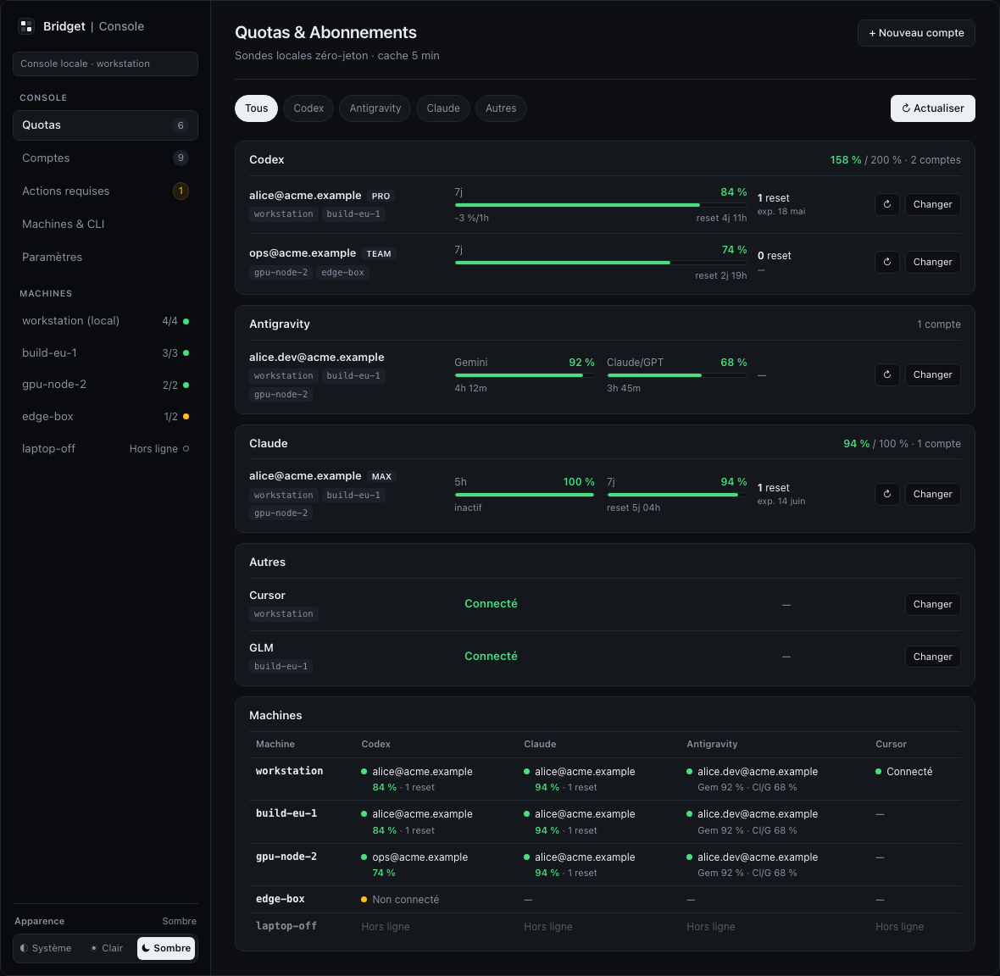
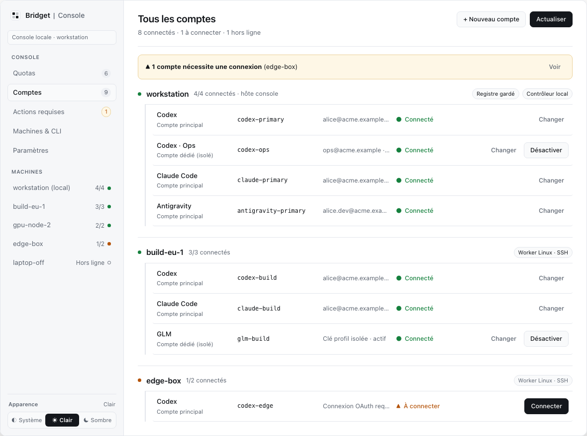
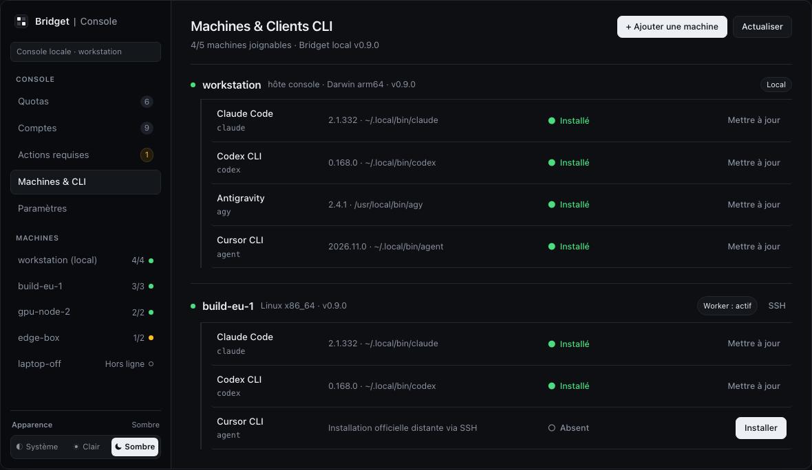
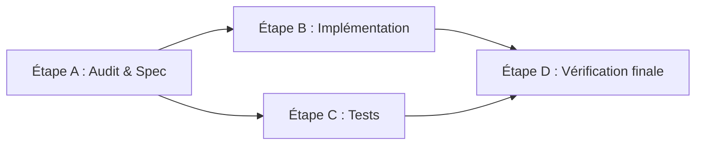

# Bridget

<p align="center"></p>

<p align="center">
  <strong>Communication locale, délégation native, graphes de tâches et console quotas zéro-jeton pour vos agents de code.</strong>
</p>

<p align="center">
  <a href="README.md">English</a> ·
  <a href="README.fr.md">Français</a> ·
  <a href="docs/README.fr.md">Documentation</a> ·
  <a href="docs/console-and-quotas.fr.md">Console Web &amp; Quotas</a> ·
  <a href="https://github.com/guthubrx/bridget/releases">Versions</a>
</p>

Bridget relie les sessions d'agents entre fournisseurs et entre machines.
Les agents se trouvent, échangent des messages, partagent un fil, délèguent
une mission et enchaînent des graphes de tâches (`A -> B + C -> D`) sans
recopier les conversations à la main ni boucler en polling. Le daemon Rust
possède les identités, les reçus, les sondes de quotas et l'état des tâches.
Les clients terminal, MCP, console web locale et Android utilisent les contrats
natifs Bridget.

<p align="center">
  
</p>

## Ce que permet Bridget

- **Communiquer :** adresser un agent, demander une réponse et vérifier l'issue enregistrée.
- **Partager le contexte :** fils partagés, brief de passation et extraits bornés du journal.
- **Déléguer et enchaîner des graphes de tâches (DAG) :** confier une mission (`bridget_auto_delegate` / `bridget_delegate`) ou décrire un graphe de dépendances complet (`bridget_delegate_graph`) dont les étapes aval démarrent automatiquement avec les résultats amont injectés et un unique réveil consolidé du parent.
- **Résilience quota intégrée :** `resume_on_limit` est actif par défaut sur la délégation automatique et les étapes de graphe (pause automatique jusqu'au reset de fenêtre, puis reprise), avec bascule inter-comptes/moteurs autorisée en option (`quota_fallback_authorized` / `fallback`).
- **Console Web locale et quotas zéro-jeton (`bridget ui` / `bridget usage`) :** affiche les quotas restants réels, les resets accumulés et leurs dates d'expiration pour Codex, Claude et Antigravity sans consommer aucun jeton LLM ; gère les comptes OAuth, profils isolés, machines SSH, déploiements CLI et mises à jour par hôte en thèmes Clair ou Sombre.
- **Travailler à distance :** fédérer vos machines en SSH et exécuter les tâches dans des worktrees Git séparés avec préparation automatique par bundle.
- **Répondre aux questions humaines :** conserver les choix et descriptions du modèle, éditer ou dicter la réponse depuis Android ou le terminal.
- **Garder le contrôle :** inspecter les files, annuler tâches ou graphes et suspendre les nouvelles délégations.

Codex, Claude Code et Cursor ACP utilisent des pilotes natifs ; Antigravity,
Gemini et GLM utilisent les parcours d'intégration pris en charge.

## Console Web et quotas zéro-jeton

Ouvrez la console locale sur `127.0.0.1` ou consultez vos abonnements directement depuis le terminal :

```sh
bridget ui                 # Ouvre la Console Web locale (Quotas, Comptes, Machines, Paramètres)
bridget ui usage           # Ouvre directement Quotas & Abonnements
bridget usage              # Résumé terminal zéro-jeton (cache 5 min)
bridget usage --refresh    # Force un relevé frais sur toutes les machines connectées
bridget usage --html       # Exporte un rapport HTML autonome
```

<details>
<summary><strong>Autres captures de la console</strong> (Comptes en thème clair &amp; Machines/CLI en thème sombre — données de démonstration 100 % synthétiques)</summary>
<br>
<p align="center">
  
</p>
<p align="center">
  
</p>
</details>

Voir le [guide Console Web et quotas zéro-jeton](docs/console-and-quotas.fr.md) pour le détail des sondes (Codex `app-server`, Claude OAuth & resets accumulés, Antigravity `/usage`, Cursor & GLM) et les garanties de confidentialité locale.

## Commencer

Installer la dernière version publiée sur macOS ou Linux :

```sh
curl -fsSL https://cartae.app/bridget/install.sh | sh
```

La même commande met à jour les fichiers et conserve les comptes et les données.
Sur une installation neuve, elle démarre Bridget, active son démarrage automatique
et vérifie sa réponse. Elle conserve les services et fédérations déjà actifs.
Voir le [guide d'installation](docs/communication-installation.fr.md).
Une ancienne version sans commande `formats` nécessite d'abord une
[migration qualifiée](docs/communication-installation.fr.md#ancien-lecteur-sans-contrôle-des-formats).

Depuis le dossier de votre projet, lancer un agent :

```sh
bridget codex
# Ou :
bridget claude
```

Lancer directement `codex` ou `claude` ne crée pas à lui seul une identité Bridget.
Un agent doit posséder une identité attestée avant d'utiliser les commandes réservées
aux agents. Un raccordement compatible peut aussi fournir cette identité.

## Communiquer

Dans une session d'agent enregistrée :

```sh
bridget who
bridget agents --json
bridget send --to '<agent_uuid>' --reply --timeout 120 -- 'Relis le contrat et signale les défauts concrets.'
bridget ledger --limit 20
```

Utiliser l'identifiant de l'annuaire. Un nom d'affichage ne donne aucun droit.
La recherche vise le même projet par défaut. Un échange volontaire entre projets
exige `--cross-project-reason`.

Les fils partagés gardent le contexte commun. Une publication silencieuse ne réveille
personne. Une demande cible ses destinataires. Tous les membres autorisés peuvent
lire le fil ; supprimer une notification ne rend pas son contenu privé.

## Déléguer et suivre

```sh
bridget delegate --catalogue --json
bridget delegate 'Analyse les tests et rends les risques principaux.'
bridget task wait '<task_id>'
bridget task status '<task_id>'
bridget task ack '<task_id>'
```

`continue`, `respond` et `cancel` couvrent la suite du cycle. Ajouter `--json`
pour un script. Le catalogue décrit les capacités déclarées ; il ne teste pas
l'authentification. Conserver l'identifiant, la clé de demande et les arguments exacts.
Si la réponse d'admission est perdue, inspecter ou rejouer cette même demande.
Une nouvelle clé peut créer une seconde mission.

La [délégation native](docs/delegation-native.fr.md) couvre les permissions,
les machines distantes, les espaces Git isolés, la continuation, la résilience quota et l'annulation.

### Graphes de tâches natifs (DAG)

Plutôt que d'attendre entre deux étapes par sondage répété, soumettez un graphe de dépendances avec `bridget_delegate_graph`. Le daemon lance les branches indépendantes en parallèle, injecte les résultats amont dans les étapes suivantes, applique la politique `on_failure` et réveille le parent une seule fois à l'issue du graphe :



Inspectez ou arrêtez un graphe en cours avec `bridget_graph_status` et `bridget_graph_cancel`.

## Commander depuis Android

Associer l'application à Bridget pour lire les conversations, envoyer un message,
consulter la file et traiter les demandes humaines. Les questions gardent les textes,
choix et descriptions du modèle. Une réponse peut être choisie, écrite ou dictée.
Le texte dicté reste éditable avant validation. Les brouillons restent sur leur
appareil ; la résolution confirmée de la question est partagée.

Le [guide Android](docs/mobile.fr.md) détaille les droits d'association,
les notifications, les aperçus et les mises à jour.

## Comprendre les reçus

| Fait | Ce qu'il prouve |
| --- | --- |
| Demande acceptée | Bridget a enregistré la demande. |
| Remise confirmée | Le transport a confirmé la remise. |
| Lecture déclarée | Le parent a explicitement déclaré avoir lu le résultat. |
| Résultat disponible | Un résultat est enregistré ; son contenu et ses preuves restent à examiner. |
| Issue inconnue | La remise ou l'exécution reste incertaine. Conserver la même clé de demande. |

Une fin de tour ne prouve pas la réussite d'une mission. Une compilation réussie
ne prouve pas que le service actif a chargé le binaire. Un résultat ne prouve pas
que les changements ont été intégrés ou déployés.

## Architecture et confidentialité

Trois crates portent le noyau : `bridget-core` pour les types et gardes communes,
`bridget-transport` pour les protocoles et pilotes, `bridget-daemon` pour le daemon,
la CLI, MCP, le stockage et le cycle des tâches.

L'état est local. Les clients locaux utilisent des sockets Unix ; la fédération
passe par votre configuration SSH. L'accès Android utilise le canal authentifié
configuré lors de l'association. Le trafic fournisseur suit le compte choisi.

Les tailles de trame, pages, files et budgets d'opération sont bornés.
Les refus distinguent un prérequis manquant d'une admission réussie.
Les secrets, bases actives et journaux bruts restent hors Git.

## Documentation

- [Installation et identité](docs/communication-installation.fr.md)
- [Console Web et quotas zéro-jeton](docs/console-and-quotas.fr.md)
- [Communication, reçus et files](docs/reference-communication.fr.md)
- [Délégation native et graphes de tâches](docs/delegation-native.fr.md)
- [Fédération SSH](docs/federation-services.fr.md)
- [Mises à jour automatiques](docs/automatic-updates.fr.md)
- [Application Android](docs/mobile.fr.md)
- [Instructions pour les agents](skills/bridget/SKILL.md)
- [Caches de compilation](docs/build-cache.fr.md)
- [Sécurité](SECURITY.fr.md)
- [Journal des versions](CHANGELOG.fr.md)

Les décisions, spécifications et preuves datées sont accessibles par
l'[index documentaire](docs/README.fr.md). Leurs résultats historiques ne prouvent
pas l'état de la version active.

## Licence

MIT. Voir [LICENSE](LICENSE).
