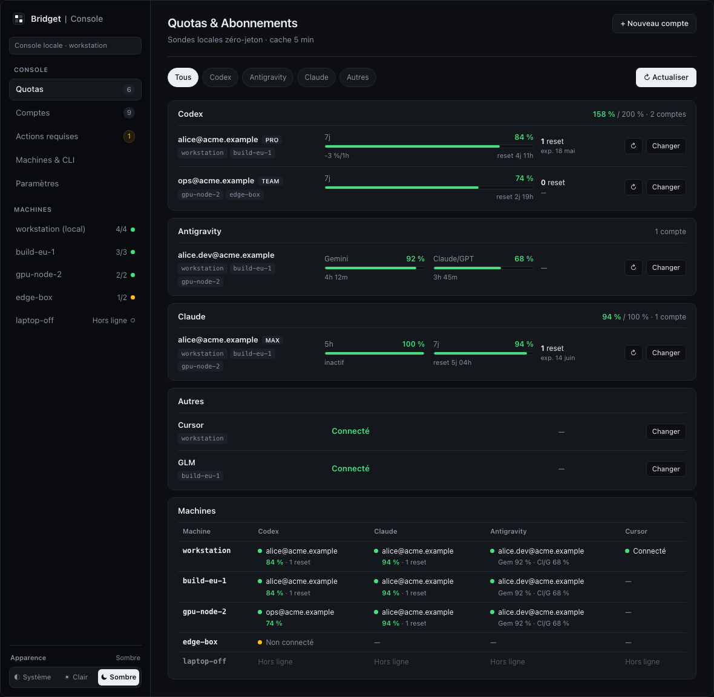
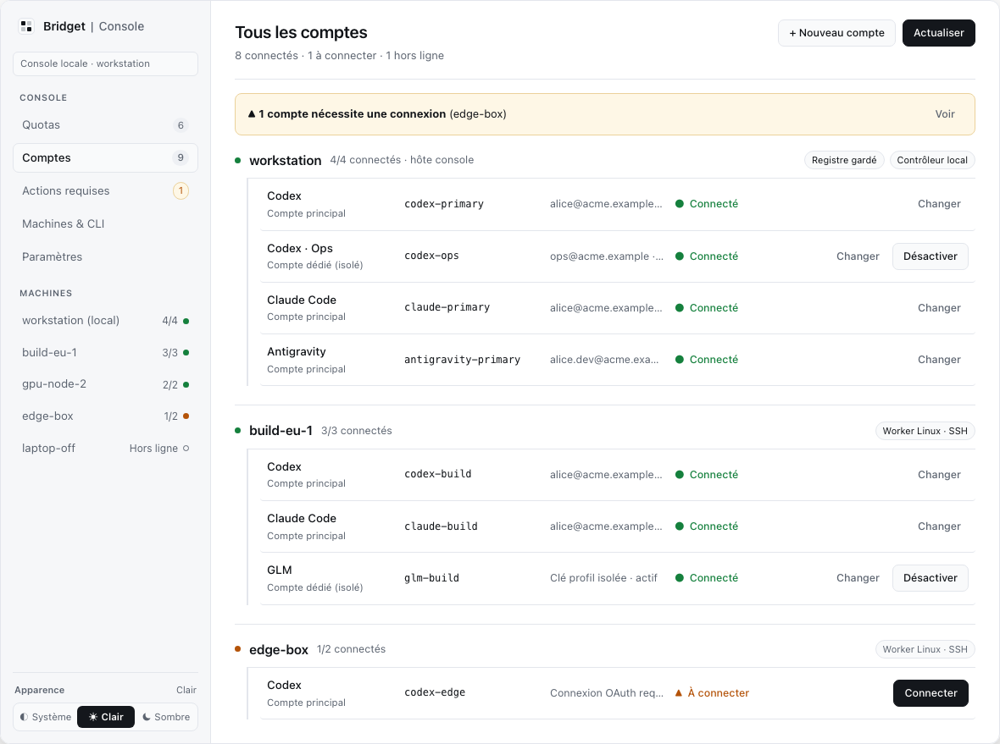
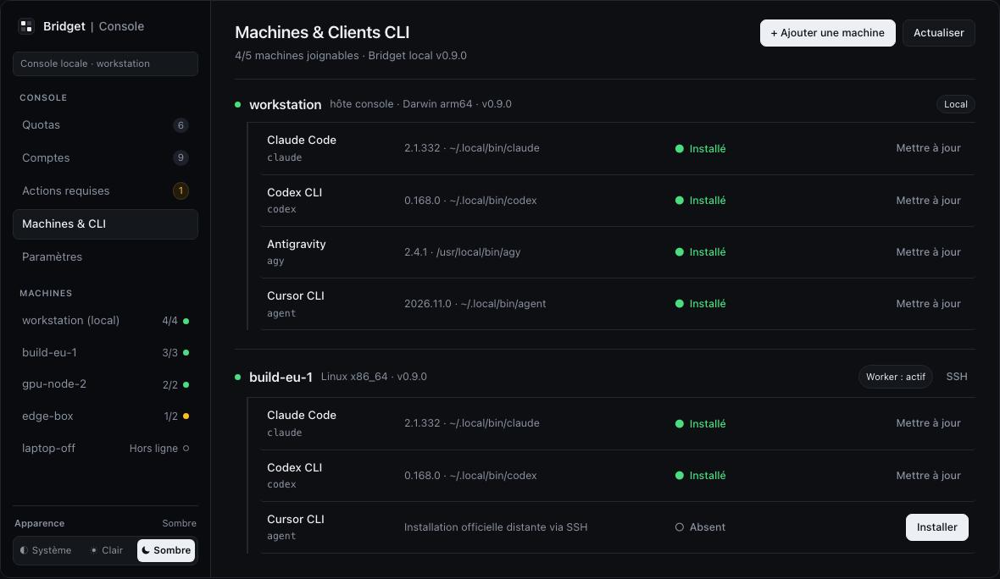
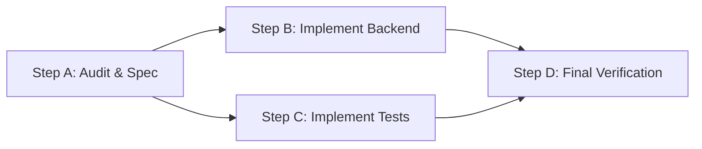

# Bridget

<p align="center"></p>

<p align="center">
  <strong>Local communication, native delegation, task graphs and zero-token quota console for your coding agents.</strong>
</p>

<p align="center">
  <a href="README.md">English</a> ·
  <a href="README.fr.md">Français</a> ·
  <a href="docs/README.md">Documentation</a> ·
  <a href="docs/console-and-quotas.md">Web Console &amp; Quotas</a> ·
  <a href="https://github.com/guthubrx/bridget/releases">Releases</a>
</p>

Bridget connects agent sessions across providers and machines. Agents can find
each other, exchange messages, ask for a reply, share a thread, delegate
missions and chain multi-step task graphs (`A -> B + C -> D`) without copying
conversations by hand or polling in a loop.

A Rust daemon owns identities, delivery receipts, quota probes and task state.
CLI, MCP, local web console and Android clients use that same authority. Bridget
owns its communication, delegation and human-question contracts across terminal,
web console and Android clients.

<p align="center">
  
</p>

## What you can do

- **Communicate:** address an agent, request a reply and inspect the recorded outcome.
- **Share context:** use shared threads, a handoff brief or a bounded journal excerpt.
- **Delegate & chain task graphs (DAG):** give a child a mission (`bridget_auto_delegate` / `bridget_delegate`), or submit an entire dependency graph (`bridget_delegate_graph`) where downstream steps launch automatically with upstream results injected and wake the parent once.
- **Built-in quota resilience:** `resume_on_limit` is enabled by default on automatic delegations and graph steps (auto-pauses on exhausted quota windows and resumes after reset), with optional cross-account/engine fallback (`quota_fallback_authorized` / `fallback`).
- **Local Web Console & zero-token quotas (`bridget ui` / `bridget usage`):** inspect real remaining quotas, banked resets and expiration dates for Codex, Claude and Antigravity without spending LLM tokens; manage OAuth accounts, isolated profiles, SSH machines, CLI deployments and per-host updates in Light or Dark mode.
- **Work remotely:** connect machines over SSH and run supported tasks in separate Git worktrees with automatic bundle preparation.
- **Answer human questions:** keep the model’s choices and descriptions, add your own text, and confirm a response from Android or a terminal. Drafts stay on their device.
- **Keep control:** inspect queues, cancel owned tasks or graphs and use human controls to halt new delegations.

Codex, Claude Code and Cursor ACP use native drivers. Antigravity, Gemini and
GLM use supported integration paths. A provider listed in the catalog still
needs an installed program, a configured account and permissions on the selected
machine.

## Web Console & Zero-Token Quotas

Open the local web console on `127.0.0.1` or check subscriptions directly from your terminal:

```sh
bridget ui                 # Launch the local Web Console (Quotas, Accounts, Machines, Settings)
bridget ui usage           # Jump directly to Quotas & Subscriptions
bridget usage              # Zero-LLM-token terminal summary (5-minute cache)
bridget usage --refresh    # Force a fresh probe across all connected hosts
bridget usage --html       # Export a standalone HTML report
```

<details>
<summary><strong>More console screenshots</strong> (Light theme Accounts &amp; Dark theme Machines/CLI — 100% synthetic demo data)</summary>
<br>
<p align="center">
  
</p>
<p align="center">
  
</p>
</details>

See the [Web Console & Quotas guide](docs/console-and-quotas.md) for probe details
(Codex `app-server`, Claude OAuth usage & banked resets, Antigravity `/usage`,
Cursor & GLM) and local-only credential boundaries.

## Start here

Install the latest published release on macOS or Linux:

```sh
curl -fsSL https://cartae.app/bridget/install.sh | sh
```

For the latest code on `main`, compiled on your machine:

```sh
curl -fsSL https://cartae.app/bridget/install.sh | sh -s -- --source
```

Run the same command to update. The installer preserves accounts and data.
On a new installation it starts Bridget, enables automatic startup and verifies
that the service responds. Existing running services and federations are preserved.
Read the [installation guide](docs/communication-installation.md) for prerequisites,
an exact release version, and standalone versus federated setup.
An older version without the `formats` command first needs a
[qualified migration](docs/communication-installation.md#older-reader-without-format-validation).

To build an existing checkout:

```sh
git clone https://github.com/guthubrx/bridget.git
cd bridget
python3 scripts/build.py cargo build --locked --release -p bridget-daemon
```

Use the toolchain declared in `rust-toolchain.toml`. This builds a candidate;
it does not replace or restart your daemon.

Once Bridget is installed and its daemon is reachable, start an agent through
the wrapper from your project directory:

```sh
bridget codex
# Or:
bridget claude
```

**Starting plain `codex` or `claude` does not by itself register a Bridget
identity.** A compatible host integration may register it separately. An agent
must have an attested identity before using agent-only communication or delegation.

Inside a registered agent session:

```sh
bridget who
bridget agents --json
bridget send --to '<agent_uuid>' --reply --timeout 120 -- 'Review the contract and report concrete defects.'
bridget ledger --limit 20
```

Use an identifier returned by the directory. A display name is not an authority.
The directory defaults to the same project. An intentional cross-project
exchange needs `--cross-project-reason`.

## Delegate and follow the result

```sh
bridget delegate --catalogue --json
bridget delegate 'Review the tests and report the main risks.'
bridget task wait '<task_id>'
bridget task status '<task_id>'
bridget task ack '<task_id>'
```

The catalog is a capability view, not an authentication test. Preserve the task
ID, request key and exact arguments. If an admission response is lost, inspect
or replay that same request; a new key can create a second mission.

Read the [delegation guide](docs/delegation-native.md) for permissions, remote
preparation, worktrees, continuation, quota resilience and cancellation.

### Native task graphs (DAG)

Instead of polling or keeping a parent agent awake between stages, submit a
dependency graph with `bridget_delegate_graph`. The daemon executes independent
branches in parallel, injects upstream results into dependent steps, handles
`on_failure` policies and wakes the parent once when the graph settles:



Inspect or stop a running graph at any time with `bridget_graph_status` and
`bridget_graph_cancel`.

## What a receipt proves

| Fact | What it means |
| --- | --- |
| Accepted request | Bridget recorded the request. |
| Delivery acknowledged | The transport acknowledged delivery. |
| Read acknowledged | The parent explicitly declared that it read the result. |
| Result available | A task result is recorded; review its contents and evidence. |
| Unknown outcome | Delivery or execution is unresolved; do not assume failure or resend under a new key. |

A turn ending is not proof that a mission succeeded. A successful build is not
proof that the active service loaded it. A result does not mean its commits
were merged or deployed.

## Privacy and boundaries

Bridget stores local state and uses Unix sockets. Federation uses your SSH
configuration supplied to Bridget. It does not require a public HTTP service.
Provider traffic still follows the selected provider and account.

Credentials, live databases and raw operational logs belong outside Git.
Messages, thread history and briefs can be read by their authorized audience;
`notify: []` suppresses notifications, not access.

See [security and privacy](SECURITY.md), the
[repository audit](docs/security-audit.md), and
[communication guarantees](docs/reference-communication.md).
No secret scanner can prove that a repository contains no sensitive information.

## Documentation

| Topic | English | Français |
| --- | --- | --- |
| Installation and terminal identity | [Guide](docs/communication-installation.md) | [Guide](docs/communication-installation.fr.md) |
| Web console, accounts and zero-token quotas | [Guide](docs/console-and-quotas.md) | [Guide](docs/console-and-quotas.fr.md) |
| Communication, receipts and queues | [Reference](docs/reference-communication.md) | [Référence](docs/reference-communication.fr.md) |
| Native delegation, task graphs and remote work | [Guide](docs/delegation-native.md) | [Guide](docs/delegation-native.fr.md) |
| SSH federation | [Guide](docs/federation-services.md) | [Guide](docs/federation-services.fr.md) |
| Automatic and per-host updates | [Guide](docs/automatic-updates.md) | [Guide](docs/automatic-updates.fr.md) |
| Android app | [Guide](docs/mobile.md) | [Guide](docs/mobile.fr.md) |
| Build cache maintenance | [Guide](docs/build-cache.md) | [Guide](docs/build-cache.fr.md) |
| Deprecations | [Register](docs/DEPRECATIONS.md) | [Registre](docs/DEPRECATIONS.fr.md) |
| Release history | [Changelog](CHANGELOG.md) | [Journal](CHANGELOG.fr.md) |

English is the default for public guides. French versions remain available.
Design decisions, specifications and dated validation records retain their
original language and are listed separately in the [documentation index](docs/README.md).
Their historical test counts are not a claim about the current checkout.

## Architecture

Three crates form the communication core:

- `bridget-core`: message types, canonical forms and shared guards.
- `bridget-transport`: wire protocol and provider transports.
- `bridget-daemon`: daemon, CLI, MCP, storage and task lifecycle.

Frame sizes, pages, queues and operation budgets are bounded. Explicit refusal
codes distinguish missing prerequisites from successful admission.

## License

MIT. See [LICENSE](LICENSE).
