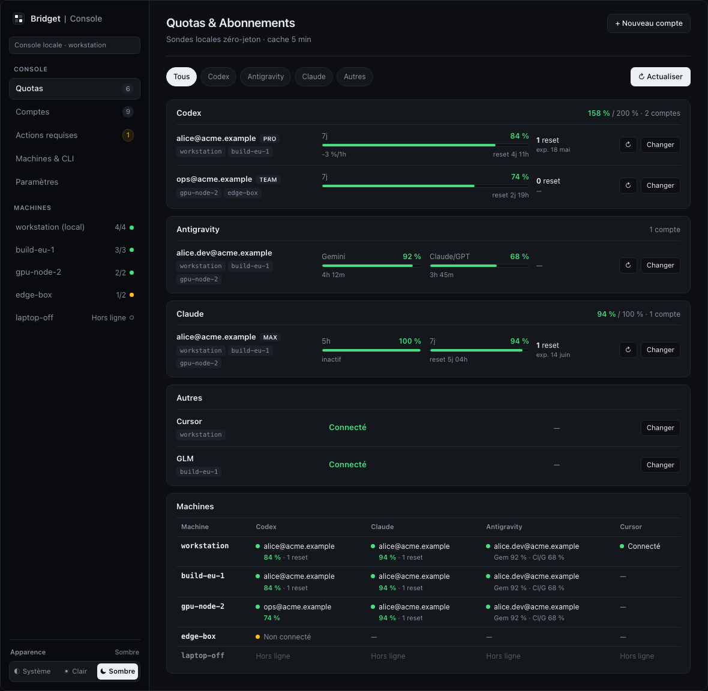
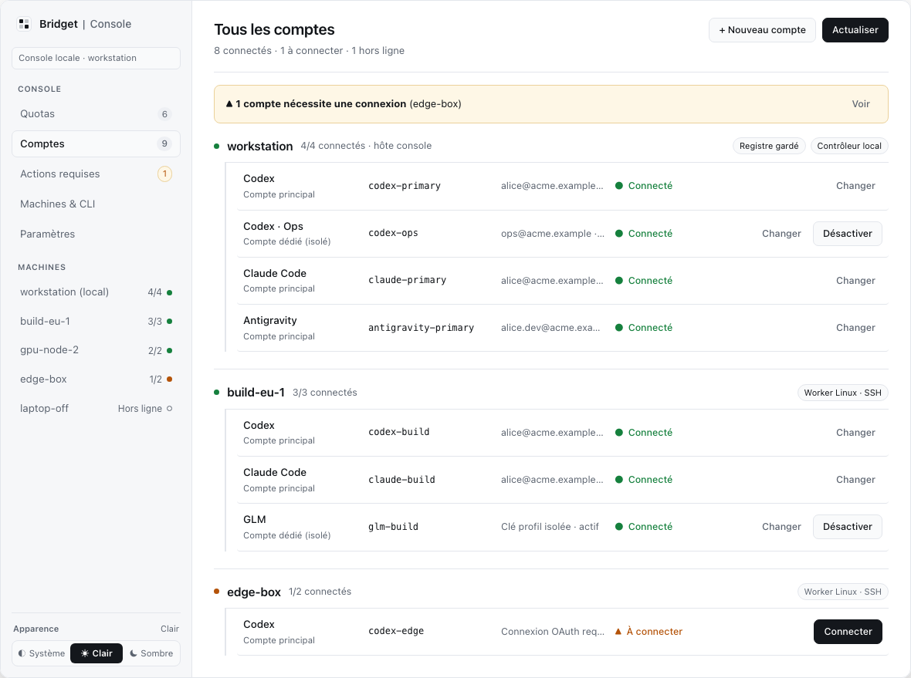
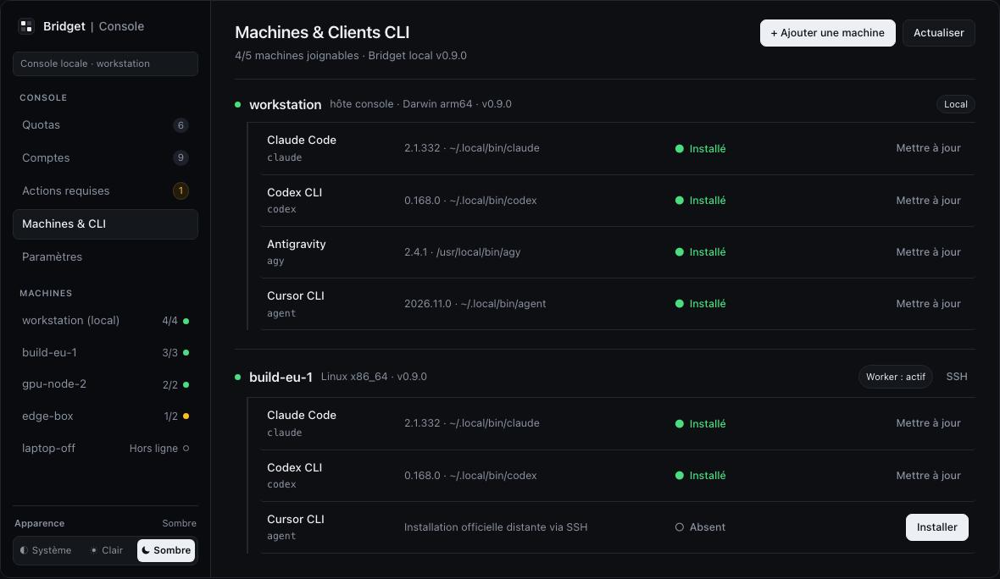

# Console Web et Quotas zéro-jeton

[English](console-and-quotas.md) · [Français](console-and-quotas.fr.md) · [Documentation](README.fr.md)

Bridget embarque une console web locale (`bridget ui`) et une sonde de quotas sans consommation de jetons LLM (`bridget usage` / `bridget_usage`) pour suivre vos abonnements, gérer vos comptes sur toutes vos machines fédérées en SSH, déployer les clients CLI et piloter les mises à jour depuis une interface unique.

## Ouvrir la console web locale

```sh
bridget ui             # Ouvre la vue par défaut
bridget ui usage       # Ouvre directement Quotas & Abonnements
bridget ui accounts    # Ouvre l'onglet Comptes
bridget ui machines    # Ouvre l'onglet Machines & Clients CLI
bridget ui settings    # Ouvre les Paramètres et mises à jour de la flotte
```

La console écoute uniquement sur `127.0.0.1`, utilise un jeton de session éphémère transmis par fragment d'URL (`#bt=...` aussitôt déplacé dans `sessionStorage`) et propose les thèmes **Système**, **Clair** et **Sombre**.

---

## Quotas & Abonnements (`bridget ui usage` / `bridget usage`)



Les comptes sont regroupés par fournisseur et dédupliqués automatiquement lorsque plusieurs machines partagent le même abonnement :

- **Codex** : interroge le protocole local `codex app-server` (`account/rateLimits/read` et `account/read`) sans consommer aucun jeton LLM. Affiche le quota restant sur 7 jours, l'évolution horaire, le compte à rebours avant réinitialisation, l'e-mail du compte, le forfait et les resets accumulés avec leur date d'expiration.
- **Antigravity** : exécute la sonde locale `/usage` (`agy -p /usage`), sépare les fenêtres **Gemini** et **Claude/GPT** et fusionne les doublons multi-machines.
- **Claude** : lit l'état local (`claude auth status`) et interroge l'API d'usage OAuth sans jeton LLM (`GET https://api.anthropic.com/api/oauth/usage?cedar_ember=1&skip_spend=1`), dédupliquée à un seul appel par e-mail de compte avec un cache de 5 minutes. Affiche les pourcentages exacts **5h** et **7j** ainsi que le nombre de resets disponibles et leurs dates d'expiration.
- **Cursor & GLM** : affiche l'état de connexion et les profils isolés.
- **Matrice Machines** : croise chaque machine de la flotte avec chaque fournisseur pour identifier d'un coup d'œil quel compte tourne où, avec cellules cliquables pour connecter ou changer de compte.

### Commandes CLI et MCP

```sh
bridget usage                        # Résumé compact en terminal (cache 5 min)
bridget usage --refresh              # Force un relevé frais zéro-jeton sur la flotte
bridget usage --provider claude      # Filtre par fournisseur (codex, claude, antigravity, cursor, glm)
bridget usage --html > quotas.html   # Export HTML autonome
bridget usage --json                 # Sortie JSON structurée pour les scripts
```

Dans une session d'agent enregistrée, l'outil MCP `bridget_usage` expose exactement la même vue (`format`, `provider`, `refresh`) à coût nul en jetons.

---

## Comptes & Profils isolés (`bridget ui accounts`)



- **Vue multi-machines** : contrôle tous les comptes connectés, à connecter, désactivés ou hors ligne par machine, avec un filtre **Actions requises**.
- **Connexion OAuth et changement de compte en un clic** : déclenche l'authentification ou la bascule de compte localement ou sur un worker distant via SSH.
- **Profils dédiés isolés** : ajoute des comptes isolés par fournisseur (`Compte dédié (isolé)`) à côté du compte principal et les active ou désactive pour le routage avec aperçu préalable sur le registre gardé.

---

## Machines SSH & Déploiement CLI (`bridget ui machines`)



- **Inventaire de flotte** : OS, architecture, version Bridget, état du worker, joignabilité SSH et versions installées des CLI (`claude`, `codex`, `agy`, `agent`).
- **Installation et mise à jour distante en un clic** : installe ou met à jour les CLI fournisseurs sur vos machines SSH via leurs commandes officielles avec suivi de progression en direct.
- **Diagnostic trousseau macOS distant** : détecte automatiquement un trousseau verrouillé ou à verrouillage automatique sur un Mac distant et propose la remédiation adaptée.

---

## Paramètres de la flotte (`bridget ui settings`)

L'onglet **Paramètres** regroupe :

- **Mises à jour Bridget par machine** : choix `Automatique`, `Manuel` ou `Défaut` pour chaque serveur, vérification manuelle et installation contrôlée. Voir [Mises à jour automatiques](automatic-updates.fr.md).
- **Automatismes de flotte (`automanaged.json`)** : mise à jour périodique des CLI officiels et synchronisation strictement additive des nouveaux modèles publiés.
- **Politique de routage** : mise en pause ou reprise du routage par machine ou connexion et réglage de `compilation_capacity` avec aperçu avant écriture.

---

## Confidentialité et périmètre des identifiants

- **Lecture strictement locale des jetons** : les jetons OAuth et clés API sont lus uniquement sur la machine qui les détient ; ils ne sont jamais journalisés, écrits dans le cache ni transmis par SSH.
- **Isolement loopback** : `bridget ui` écoute exclusivement sur `127.0.0.1` et n'ouvre aucun service HTTP public.
- **Cache borné** : le cache de 5 minutes conserve uniquement les pourcentages agrégés, les échéances de réinitialisation et les libellés d'affichage.
