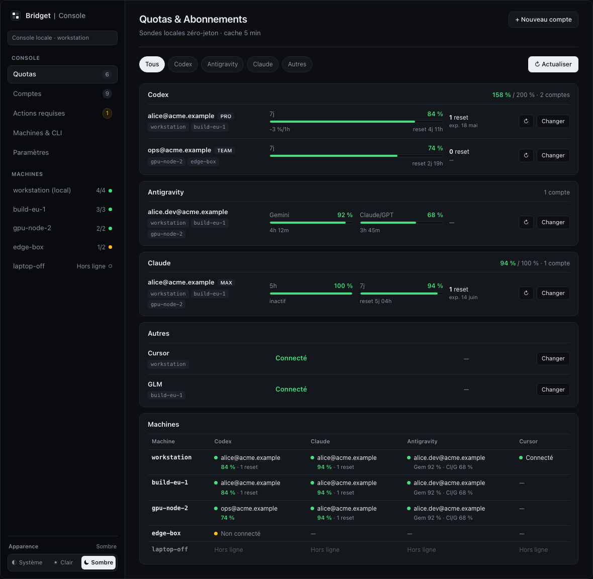
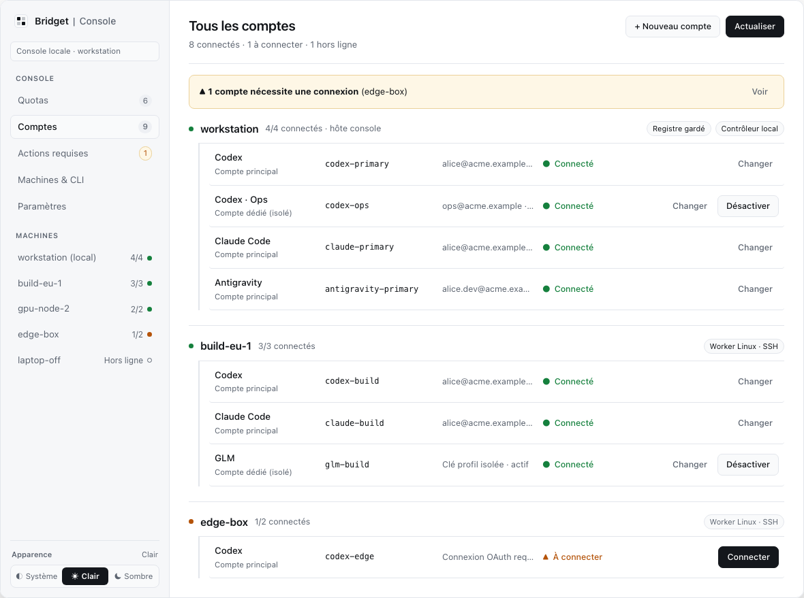
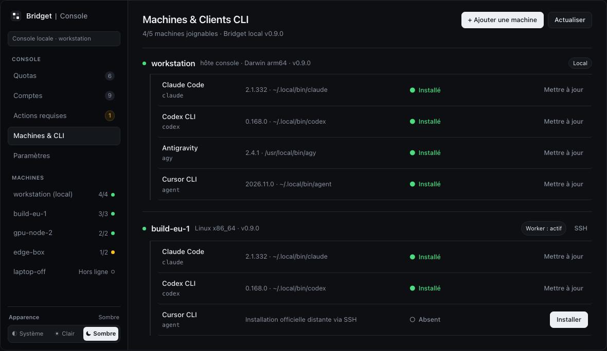

# Web Console and Zero-Token Quotas

[English](console-and-quotas.md) · [Français](console-and-quotas.fr.md) · [Documentation](README.md)

Bridget includes a local web console (`bridget ui`) and a zero-LLM-token quota probe (`bridget usage` / `bridget_usage`) to inspect subscriptions, manage accounts across SSH-federated machines, deploy provider CLIs and configure fleet updates from one interface.

## Launch the local web console

```sh
bridget ui             # Open the default console view
bridget ui usage       # Open directly on Quotas & Subscriptions
bridget ui accounts    # Open on Accounts across machines
bridget ui machines    # Open on SSH Machines & CLI deployment
bridget ui settings    # Open on Fleet Settings & Update policies
```

The console binds exclusively to `127.0.0.1`, issues an ephemeral session token passed via the URL fragment (`#bt=...` immediately stripped into `sessionStorage`), and exposes **System**, **Light**, and **Dark** themes.

---

## Quotas & Subscriptions (`bridget ui usage` / `bridget usage`)



Accounts are grouped by vendor and deduplicated across machines that share the same credentials:

- **Codex**: queries the local `codex app-server` protocol (`account/rateLimits/read` and `account/read`) with zero LLM tokens consumed. Displays remaining 7-day quota, hourly delta, reset countdown, account email, plan badge, and banked manual resets with their expiration dates.
- **Antigravity**: queries the local `/usage` probe (`agy -p /usage`), reports independent **Gemini** and **Claude/GPT** windows, and deduplicates identical accounts across connected machines.
- **Claude**: reads the local account status (`claude auth status`) and runs a zero-token OAuth usage probe (`GET https://api.anthropic.com/api/oauth/usage?cedar_ember=1&skip_spend=1`) deduplicated to one request per unique account email with a 5-minute cache. Displays exact **5h** and **7d** remaining percentages along with banked manual resets and expiration dates.
- **Cursor & GLM**: displays live connection status and dedicated isolated profiles.
- **Machines matrix**: maps every host in the federation against each provider so you can see which account runs where and click any cell to connect or switch accounts.

### CLI and MCP commands

```sh
bridget usage                        # Compact terminal summary (uses 5-minute cache)
bridget usage --refresh              # Force fresh zero-token probes across hosts
bridget usage --provider claude      # Filter by provider (codex, claude, antigravity, cursor, glm)
bridget usage --html > quotas.html   # Standalone HTML report
bridget usage --json                 # Structured JSON payload for scripts
```

Inside a registered agent session, the `bridget_usage` MCP tool exposes the same cached snapshot (`format`, `provider`, `refresh`) without spending model tokens.

---

## Accounts & Isolated Profiles (`bridget ui accounts`)



- **Multi-machine view**: inspect every connected, unauthenticated, disabled, or offline account per machine from one screen, with an **Actions required** filter for credentials needing login.
- **One-click OAuth login & account switching**: launch provider sign-in or switch accounts directly on the local host or over SSH on remote workers.
- **Dedicated isolated profiles**: create isolated per-provider accounts (`Compte dédié (isolé)`) alongside primary accounts and toggle them on or off for fleet routing with a preview step before modifying the guarded registry.

---

## SSH Machines & CLI Deployment (`bridget ui machines`)



- **Fleet inventory**: inspect OS, architecture, Bridget daemon/worker version, SSH reachability, and installed provider CLIs (`claude`, `codex`, `agy`, `agent`).
- **One-click official CLI installation & updates**: install or update provider CLIs remotely over SSH with live progress feedback, using each provider's official installation path.
- **Remote macOS keychain diagnostics**: detects locked or auto-locking keychains on remote macOS workers and offers targeted one-click or copyable SSH remediation.

---

## Fleet Settings (`bridget ui settings`)

The **Settings** tab centralizes:

- **Per-host Bridget updates**: switch each machine between `auto`, `manual`, or fleet `default`, trigger a check, or start a verified release installation. See [Automatic updates](automatic-updates.md).
- **Fleet automation (`automanaged.json`)**: enable or disable periodic official CLI updates and additive model catalog synchronization across reachable hosts.
- **Routing policy**: pause or resume routing per machine or per connection and adjust `compilation_capacity` with preview confirmation.

---

## Privacy and Credential Boundaries

- **Local-only credential reads**: OAuth tokens and API keys are read strictly on the host that owns them; they are never logged, persisted in cache files, or transmitted over SSH.
- **Loopback isolation**: `bridget ui` listens only on `127.0.0.1` and never opens a public HTTP port.
- **Bounded cache**: usage snapshots are cached for 5 minutes and store only aggregate percentages, reset timestamps, and display labels.
